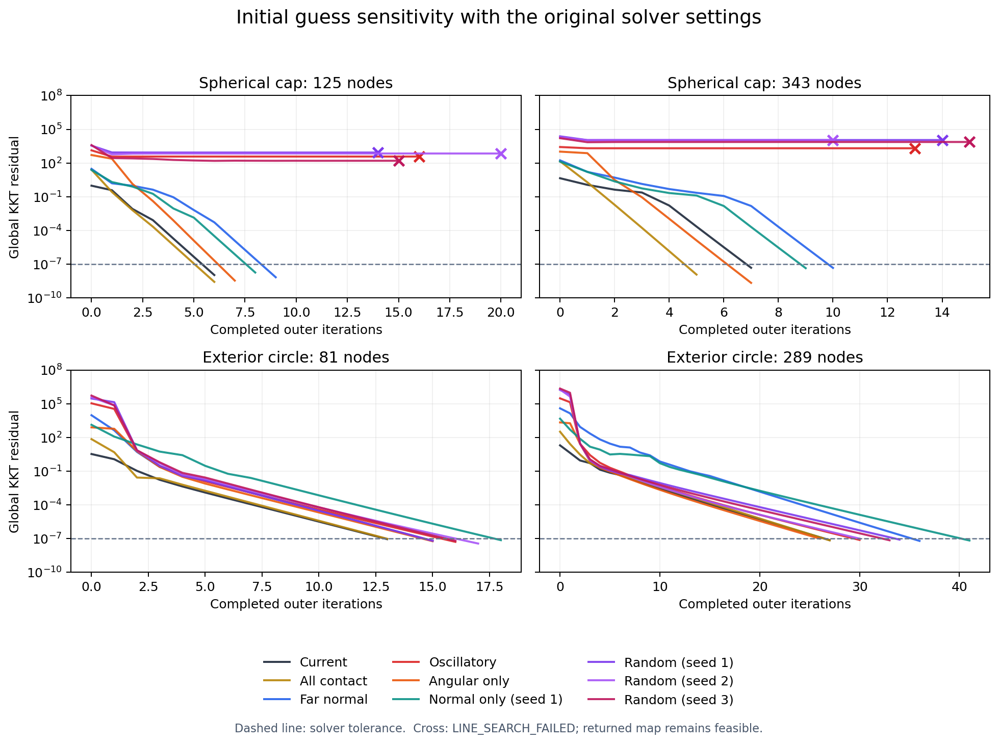

# Initial guess sensitivity of the spherical-cap and exterior-circle benchmarks

Rerun on 2026-11-15. The exterior-circle solver recovered the control solution
from all eight adverse initial guesses on both meshes. The spherical-cap solver
recovered it from five of the nine total guesses on each mesh, but failed its
line search for the combined angular/normal oscillations and all three combined
random guesses. Every returned map, including failed runs, remained feasible.

The original examples, initial fields, verification tests, and nonlinear solver
are preserved. The experiment is a separate executable:
[obstacle_map_initial_guess.cpp](../../../cpp/mainFiles/obstacle_map_initial_guess.cpp).



[PDF figure](convergence.pdf), [all 36 results](results.csv),
[outer iteration histories](iterations.csv), [console log](run.log).

## Matched settings and controls

These runs match the table in the request: `k=1`, contact half-width `a=0.3`,
spherical angle `alpha=acos(-0.5)`, collar radius `0.01`, global residual
tolerance `1e-7`. They use the same fitted P1 meshes, degree-two quadrature,
exact Dirichlet trace, and default `ObstacleMapOptions` as
`profileRefinement()` in `cpp/test/test_obstacle_map.cpp`. The default outer
limit is 500; the QP limit is 1000, `sigma=0.1`, and one bulk sweep is used.
No solver parameters were adjusted to accommodate the adverse guesses.
The main `obstacle_map` example uses a different `k=2.712423`; it is unchanged.

The current-IC controls reproduce the supplied table:

| Benchmark | Nodes | Iterations | Global residual | Physical L2 error |
| --- | ---: | ---: | ---: | ---: |
| Spherical cap | 125 | 6 | 1.0708e-8 | 8.879238e-3 |
| Spherical cap | 343 | 7 | 4.7328e-8 | 5.509075e-3 |
| Exterior circle | 81 | 13 | 8.8932e-8 | 1.105449e-2 |
| Exterior circle | 289 | 27 | 7.3261e-8 | 2.395641e-3 |

The global residual is the sum of the mass-scaled tangential stationarity
residual and the normal complementarity residual. Physical errors compare
`F(q_h)` to the reference map, after interpolating the coordinate field on each
simplex. The same quadrature is used to compare a run with its current-IC control.

## Initial guesses

Write `q=(s,r)`, with `r>=0`. All formulas below specify free nodes only; the
solver replaces every boundary node with the same exact trace in every run.
All initial maps satisfy the whole-simplex target certificate. Initial and final
VTK snapshots and accepted-block energy histories are written to the run directory.

Set `L=alpha-0.051` for the sphere and `L=20` for the circle. Thus the spherical
far-normal guess has polar angle `0.051`, just `0.001` above the chart cutoff;
the circle far-normal guess has physical radius 21. Define

```
p = 5.3*x + 3.7*y                 (2D)
p = 5.3*x + 3.7*y + 2.1*z         (3D)
```

| Guess | Initial longitude s | Initial normal coordinate r |
| --- | --- | --- |
| Current | `k*x + .04*sin(x+.7*y)` | `.08+.01*cos(x)+.02*y*y` |
| All contact | `-k*x` | `0` |
| Far normal | `-k*x` | `L` |
| Oscillatory | `-k*x + 4*pi*sin(p)` | `L*(.5+.49*cos(1.7*p+.4))` |
| Angular only | Same as oscillatory | Same as current |
| Normal only, seed 1 | `k*x` | `L*(.001+.998*V)` |
| Random, seeds 1, 2, 3 | `8*pi*(2*U-1)` | `L*(.001+.998*V)` |

`U,V` are reproducible nodal values in `[0,1)`, generated by hashing the source
coordinates and the listed seed. The normal-only run uses the same `V` as random
seed 1. Neither random nor oscillatory normal fields use the exact contact slab.
The angular guesses are unwrapped coordinate fields; no longitude wrapping or
projection is performed before solving. The seeds specify three deterministic
trials, not a statistical sampling claim.

## Results

The entries below are completed outer iteration counts. `FAIL` means
`LINE_SEARCH_FAILED`; a failed cycle can include accepted blocks before its
failure. All other entries converged below `1e-7`.

| Initial guess | Sphere, 125 nodes | Sphere, 343 nodes | Circle, 81 nodes | Circle, 289 nodes |
| --- | ---: | ---: | ---: | ---: |
| Current | 6 | 7 | 13 | 27 |
| All contact | 6 | 5 | 13 | 27 |
| Far normal | 9 | 10 | 15 | 36 |
| Oscillatory | FAIL (16) | FAIL (13) | 16 | 30 |
| Angular only | 7 | 7 | 15 | 26 |
| Normal only, seed 1 | 8 | 9 | 18 | 41 |
| Random, seed 1 | FAIL (14) | FAIL (14) | 15 | 34 |
| Random, seed 2 | FAIL (20) | FAIL (10) | 17 | 30 |
| Random, seed 3 | FAIL (15) | FAIL (15) | 16 | 33 |

For a direct replacement of the four-row table, using the combined random
initial guess with seed 1:

| Benchmark | Nodes | Status | Global residual | Physical L2 error of returned map |
| --- | ---: | --- | ---: | ---: |
| Spherical cap | 125 | LINE_SEARCH_FAILED | 8.5209e2 | 2.036980 |
| Spherical cap | 343 | LINE_SEARCH_FAILED | 1.1010e4 | 2.692486 |
| Exterior circle | 81 | CONVERGED | 6.3955e-8 | 1.105449e-2 |
| Exterior circle | 289 | CONVERGED | 8.1183e-8 | 2.395641e-3 |

The sphere errors in that table describe failed iterates and must not be
reported as errors of converged solutions.

Every successful run has exactly the same free-node contact classification as
its control. The largest physical L2 difference from the control is `5.34e-10`
for the sphere and `3.12e-9` for the circle, far below their discretization errors.
The circle's largest initial energy is `1.31436e7`, versus final energy about
`2.51`; it still recovers the control solution. Adverse circle guesses need
13--18 iterations on the coarse mesh and 26--41 on the finer mesh.

## What fails for the sphere

The spherical chart requires

```
0 <= r < alpha - 0.05 = 2.044395102393196...
```

All eight failed runs approach this artificial chart boundary: the final gap
`alpha-0.05-max(r_i)` is between `4.3e-14` and `9.4e-11`. Their global residuals
remain between about `1.58e2` and `1.10e4`. They exhaust the 40 allowed
backtracks after 10--20 completed outer iterations, well before the outer
iteration limit. Energy decreases do not establish stationarity here.

Large longitude gradients can make it energetically attractive to move toward
the north pole, where the longitude metric coefficient `sin(alpha-r)^2`
shrinks. The observed approach to the cutoff is consistent with this mechanism.
The QP enforces the obstacle's lower bound on `r`; the chart's upper restriction
is enforced by rejecting inadmissible line-search candidates. There is no
chart transition or regular coordinate representation of the pole in this
implementation. The finite element coordinate field and its large longitude
oscillations also affect this behavior.

The angular-only and normal-only controls both converge, showing that the
combined perturbations are decisive among these tested guesses. These results
show sensitivity of the current spherical coordinate implementation. They do
not establish nonexistence of a minimizer, a distinct stationary solution, or
failure of an intrinsic method able to change charts. The circle chart has no
analogous polar cutoff; all tested guesses recover the same discrete solution.

## Reproduce

Using the existing serial experiment build:

```sh
cmake -S . -B build/obstacle-explore -DUSE_MPI=OFF -DUSE_MUMPS=OFF \
  -DUSE_UMFPACK=OFF -DCUTFEM_CREATE_DOCS=OFF \
  -DCUTFEM_BUILD_OBSTACLE_MAP_TESTS=ON
cmake --build build/obstacle-explore \
  --target obstacle_map_initial_guess obstacle_map_tests -j 4
build/obstacle-explore/bin/obstacle_map_initial_guess \
  --output build/obstacle-explore/initial-guess-rerun
```

The experiment returns 0 if all runs converge, 1 if it records any failed
solves, and 2 for an experiment error. The recorded default study returns 1
because it includes the eight spherical failures. Every case is still run and
saved. Use a fresh output directory to retain earlier outputs.

```sh
ctest --test-dir build/obstacle-explore -R '^obstacle_map$' --output-on-failure
MPLCONFIGDIR=/tmp/cutfem-mpl python3 tools/plot_obstacle_initial_guess.py \
  build/obstacle-explore/initial-guess-rerun \
  --output build/obstacle-explore/initial-guess-rerun/convergence
```

Matplotlib is needed only for the figure. The plotting script can also read
the two archived CSVs in this directory. Optional executable flags are
`--max-iterations N` and `--tol T`; changing them changes the experiment.

For every returned map the executable checks whole-element feasibility, exact
boundary values, independently reassembled residuals and reactions, the
convergence tolerance when success is reported, and energy decrease across
accepted blocks. The original obstacle-map numerical suite passes. The archived
CSV histories have also been checked against all 36 returned summaries.

`iterations.csv` contains an `outer` event for the initial map and each completed
outer cycle, plus a `returned` event. The final event preserves any accepted
blocks in an unfinished cycle and can share its iteration number with an
earlier row. `results.csv` stores initial and final diagnostics, free-node
contact differences, physical L2 differences, solver step counts, and wall time;
wall time depends on the machine and concurrent activity.
