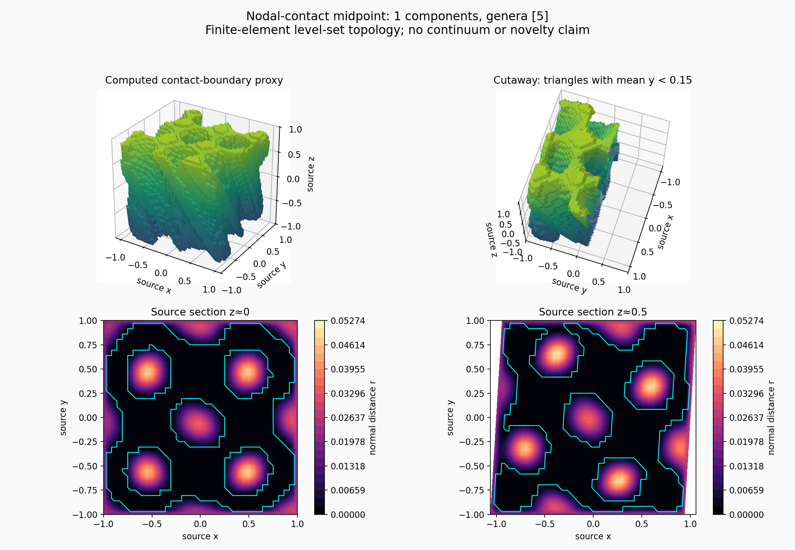
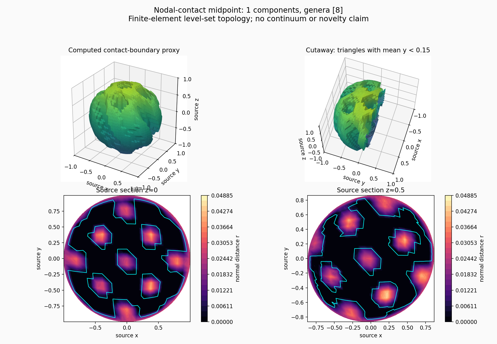
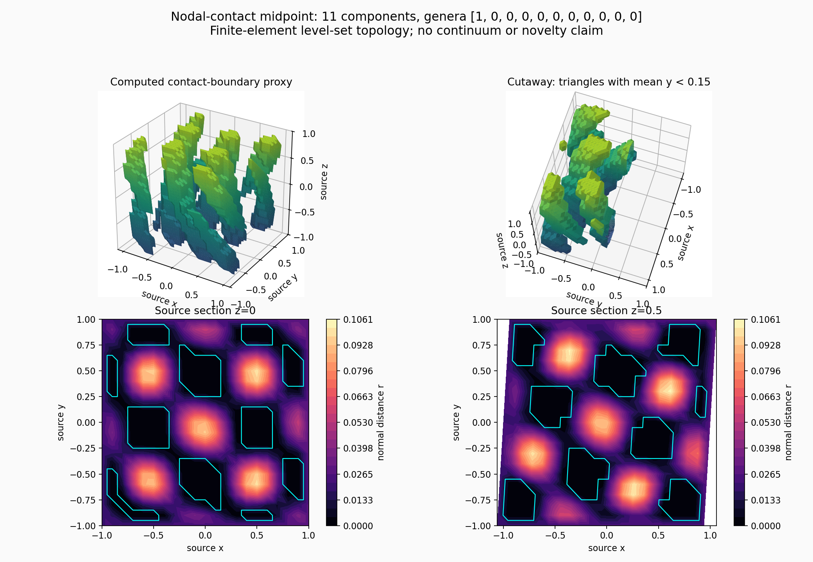

# A computed labyrinth of contact tunnels

This is an exploratory obstacle-map experiment, started on 2026-09-30. It
produces a perforated contact region with bent tunnels, narrow bridges, and
parameter-dependent detached pockets. It is a **candidate for further mathematical
study**, not a claim of a new theorem, a new topological type, or an established
previously unknown free boundary. The topology of individual narrow handles is
sensitive to discretization and to the surface extraction method.

The free boundary discussed here lives in the **three-dimensional source**:
`Gamma = boundary({x : r(x)=0}) intersect Omega`. It is not the target boundary,
and it is not the mapped image of the free boundary. The numerical output is a
stationary point of the existing quadrature-defined P1 energy. Minimality is not
certified.

## Construction

The implementation is [labyrinth.hpp](../../../cpp/example/obstacle_map/labyrinth.hpp),
with the executable declared in
[obstacle_map_labyrinth.cpp](../../../cpp/mainFiles/obstacle_map_labyrinth.cpp).
The original obstacle-map example, energy assembly, nonlinear algorithm, and
quadratic solver are unchanged.

Start with the library box mesh of `[-1,1]^3`, and shear its vertices by

\[
 (X,Y,Z)\mapsto (X+0.12YZ,Y,Z).
\]

The actual source is the resulting fitted tetrahedral domain; its element maps
are affine. An alternative starts from the existing fitted ball mesh and uses
the same shear. On physical source coordinates use

\[
 g^{-1}(x)=I+0.25v(x)v(x)^T,\quad
 v(x)=(\cos(1.1z),\sin(1.1z),0.35),\qquad
 \sqrt{\det g}=(1+0.25|v|^2)^{-1/2}.
\]

The target is the intrinsic Riemannian half-space `(s,t,r) in R^2 x [0,infinity)`
with metric

\[
 G=dr^2+e^{2\kappa(s,t)r}
      (ds^2+0.44\,ds\,dt+1.25\,dt^2),
\]

\[
 \kappa(s,t)=b-\cos(\pi s)\cos(\pi t)
       +0.18\sin(\pi(s+t))+0.12\cos(\pi(2s-t)+0.3).
\]

The main candidate uses `b=0.45`. This changes the intrinsic geometry, not merely
its coordinate names. The constant tangential matrix
`B=[[1,.22],[.22,1.25]]` has determinant `1.2016>0`.
Every target curve has length at least its total change in `r`; the vertical
curve attains that length. Thus **r is the exact distance to the obstacle**, and
these are global Fermi coordinates without poles, cuts, or periodic lift issues.
The metric is periodic in `s,t`, but these coordinates are real coordinates;
no periodic identification is imposed.

For numerical conditioning, the element certificate uses the convex prism
`0<=r<=1`. All reported candidates remain far from its upper edge. This upper
edge is not treated by the solver as an additional obstacle. The callback
`embed(q)=q` is solely a coordinate visualization: the target is **not** asserted
to have this metric induced by its identity embedding into Euclidean space.
Do not interpret the VTK `u0,u1,u2` coordinates as an isometric target embedding.

Write `theta=0.65z`. Prescribe only the exterior source trace:

\[
 s=2(x\cos\theta-y\sin\theta)+0.13z,\quad
 t=2(x\sin\theta+y\cos\theta)-0.09z,\quad
 r=0.025(1+0.12x+0.08yz).
\]

All boundary normal values are strictly positive. Cold starts have a perturbed
tangential field and strictly positive `r` at every free node; no contact set
or free-boundary profile is supplied. Warm starts use convex trilinear
interpolation of a previous computed field on the unsheared box coordinates.
Boundary values are imposed afresh by the solver.

## Why holes appear

In a smooth contact interior, the normal equation has reaction

\[
 \lambda=\kappa(s,t)B_{ab}
       \langle\nabla s^a,\nabla s^b\rangle_g.
\]

Where tangential energy is nonzero, negative `kappa` is incompatible with
nonnegative contact reaction. Alternating signs therefore favor contact in some
target regions and release in others. The coupled tangential solve changes the
preimages of those regions; the rotation in the trace bends the resulting
channels through the source. The equation determines their walls and bridges.
This is a mechanism suggested by the chosen metric, not an independent proof
of the numerical topology.

This construction is related to the curvature dichotomy in the local manuscript
[Regularity of obstacle maps between manifolds with boundary](../../../../obstacle-maps-regularity/mfd-obstacle-maps.tex).
Unlike its separated warped-product ODE examples, the warp here depends on
both tangential coordinates as well as distance. It also differs from the
parallel-disc and Veronese constructions in
[Some examples of obstacle maps between balls and spherical caps](../../../../obstacle-maps-examples/Main.tex).
These comparisons do not establish novelty.

## Numerical evidence



The finest run has 50,653 nodes and 279,936 tetrahedra, converges in 13 outer
iterations to energy `40.6223727438`, and has global KKT residual `7.23e-7`.
Its distance remains in `[0,0.052737]`, well inside the certificate's upper
limit. The extracted surface is connected, closed, and has Euler characteristic
`-8` (genus five) at `r=1e-5`, `r=1e-4`, and the contact-indicator midpoint.
At `r=1e-3` the proxy has genus six. Thus the strongest observed geometry is a
connected region with five bent through-tunnels, but its exact continuum genus
is **not certified**. Earlier coarse grids gave different handle counts.

| Run | Subdivisions | Energy | KKT residual | Genus at `1e-5 / 1e-4 / 1e-3 / indicator` |
| --- | ---: | ---: | ---: | --- |
| base12 | 12 | 40.919412817 | 5.56e-07 | 7 / 7 / 6 / 7 |
| base20 | 20 | 40.713803400 | 6.04e-08 | 10 / 9 / 9 / 10 |
| base28 | 28 | 40.648938945 | 9.08e-07 | 9 / 9 / 5 / 9 |
| base36 | 36 | 40.622372744 | 7.23e-07 | 5 / 5 / 6 / 5 |
| ball12 | 12 | 34.172205306 | 4.48e-07 | 9 / 9 / 8 / 9 |
| ball20 | 20 | 34.158569758 | 5.56e-07 | 8 / 8 / 7 / 8 |
| positive12 | 12 | 41.499588345 | 1.62e-07 | 0 / 0 / 0 / 0 |

The 20-subdivision box runs from seeds 0 and 3 agree to `4.21e-10` in every
coordinate, have identical contact labels, and agree in energy to roundoff.
Restarting that computed field on the same grid returns convergence in zero
outer iterations. These checks support reproducibility of the stationary
point; they are not a uniqueness or minimality proof.

At curvature bias `b=1.5`, the bound `kappa>=1.5-1-.18-.12=.20` holds globally.
That control produces one genus-zero proxy at every tested extraction level.
At `b=.15`, the coarse grid gives three components, while the 20-subdivision
active-indicator proxy gives eleven (including two tiny components). Some
coarse bridges therefore do not survive refinement. This lower-bias result is
useful evidence of sensitivity, not a confirmed topology-change theorem.





The independently checked metric derivatives differ from centered finite
differences by at most `1.62e-10`. The assembled energy directional derivative
check differs by `7.51e-9`. All four CTest suites pass, including the original
QP, map, and embedding-geometry suites. Analytic sphere and torus fixtures
independently verify the extraction/edge/vertex-link/Euler-characteristic code;
an affine-field test verifies interpolation on source sections. The torus is
only a validation fixture, not the proposed shape.

Machine-readable solver diagnostics and topology measurements are in
[results.json](results.json). The generated
[finest surface VTK](../../../build/obstacle-explore/runs/base36_surface.vtk)
and [full field VTK](../../../build/obstacle-explore/runs/base36.vtk) are available
locally for ParaView after running the reproduction commands. Small increases in accepted energy, where present,
are within the solver's floating-point allowance, roughly `6e-13` for these
energies. Every completed experiment reports zero boundary-coordinate error
and nonnegative nodal normal coordinates. No run claims contact from an
unconverged iterate; the analyzer rejects nonconverged summaries.

## Surface extraction and interpretation

[analyze_obstacle_labyrinth.py](../../../tools/analyze_obstacle_labyrinth.py)
extracts level sets directly on the actual tetrahedra, sharing intersection
vertices by FE edge. It does not voxelize or smooth the result. It reports:

- the positive distance levels `r=1e-5,1e-4,1e-3`;
- optionally, the midpoint level of the P1 nodal noncontact indicator
  `1_{r_i>1e-7}`;
- connected components, Euler characteristics, surface areas, and enclosed
  signed Euclidean source volumes;
- genus only after checking that every edge has two incident faces and every
  vertex link is one cycle.

These are **offset or indicator proxies**. Neither is the exact continuum free
boundary. In particular, a P1 field is zero throughout fully active tetrahedra,
and its contact set need not itself have a smooth manifold boundary. Changing
the offset can fill a small tunnel or join two nearby components. Reported areas
and volumes are Euclidean source-coordinate measurements, not target-intrinsic
quantities or source-metric measures. Fixed positive levels do not converge to
`r=0` merely by refining the mesh.

## Reproduce

From the repository root:

```sh
cmake -S . -B build/obstacle-explore -DUSE_MPI=OFF -DUSE_MUMPS=OFF -DUSE_UMFPACK=OFF -DCUTFEM_CREATE_DOCS=OFF -DCUTFEM_BUILD_OBSTACLE_MAP_TESTS=ON
cmake --build build/obstacle-explore --target obstacle_map_labyrinth obstacle_labyrinth_tests obstacle_map_tests obstacle_target_tests bound_quadratic_tests -j 4
ctest --test-dir build/obstacle-explore --output-on-failure
python3 tools/test_obstacle_labyrinth_analysis.py

build/obstacle-explore/bin/obstacle_map_labyrinth --subdivisions 12 --output build/obstacle-explore/runs/base12
build/obstacle-explore/bin/obstacle_map_labyrinth --subdivisions 20 --output build/obstacle-explore/runs/base20
build/obstacle-explore/bin/obstacle_map_labyrinth --subdivisions 28 --output build/obstacle-explore/runs/base28
build/obstacle-explore/bin/obstacle_map_labyrinth --subdivisions 36 --warm-start build/obstacle-explore/runs/base20_nodes.csv --output build/obstacle-explore/runs/base36
python3 tools/analyze_obstacle_labyrinth.py build/obstacle-explore/runs/base36 --active --plot
```

The Python tools need NumPy and Matplotlib. Independent starts and controls:

```sh
build/obstacle-explore/bin/obstacle_map_labyrinth --subdivisions 20 --seed 3 --output build/obstacle-explore/runs/seed20
build/obstacle-explore/bin/obstacle_map_labyrinth --subdivisions 12 --bias .15 --output build/obstacle-explore/runs/lowbias12
build/obstacle-explore/bin/obstacle_map_labyrinth --subdivisions 20 --bias .15 --warm-start build/obstacle-explore/runs/lowbias12_nodes.csv --output build/obstacle-explore/runs/lowbias20
build/obstacle-explore/bin/obstacle_map_labyrinth --subdivisions 12 --bias 1.5 --output build/obstacle-explore/runs/positive12
build/obstacle-explore/bin/obstacle_map_labyrinth --subdivisions 12 --ball --scale 2.6 --output build/obstacle-explore/runs/ball12
build/obstacle-explore/bin/obstacle_map_labyrinth --subdivisions 20 --ball --scale 2.6 --output build/obstacle-explore/runs/ball20
```

Use `--help` for tunable geometry and solver parameters. The fine cold starts
can be slow because the existing QP active-set method handles individual
blocking/released constraints. The experiment increases its iteration budget
from 1,000 to 20,000; it does not change the algorithm or relax the global
residual tolerance. Exit status zero still requires convergence. Warm-start
CSV files must use the same box shear; interpolation supplies initial values,
not a frozen contact mask.

The output prefix gives the full mesh VTK, shared-node and cell CSVs, energy
history, and solver summary. The analyzer adds a topology JSON, a surface-only
VTK suitable for ParaView, and a PNG when requested. Full raw meshes remain in
`build/obstacle-explore/runs/`; the compact results and selected figures below
are retained with this note.

## What would constitute a mathematical advance

A visually unfamiliar surface, or a large genus, does not itself establish
novelty. Relevant prior work already treats the interaction of geometry,
branch points, and free boundaries, including
[Figalli–Guerra–Kim–Shahgholian, Constraint maps: singularities vs free boundaries](https://arxiv.org/abs/2407.21128)
and their [Constraint Maps and Free Boundaries survey](https://cvgmt.sns.it/media/doc/paper/6863/Constraint-Maps-and-Free-Boundaries.pdf).
The scalar theory also allows substantial geometric freedom when the usual
nondegeneracy restrictions are absent. A targeted literature search did not
establish priority for this specific experiment.

A useful next research claim would concern **existence and persistence of a
particular tunnel network for minimizers under explicit metric and trace
conditions**, or a rigorously controlled change of topology as `b` varies.
That would require finer/adaptive and independently remeshed computations,
a joint mesh/offset study, stability or minimality analysis, and ultimately
analytic estimates. The present KKT residuals do not provide those results.
